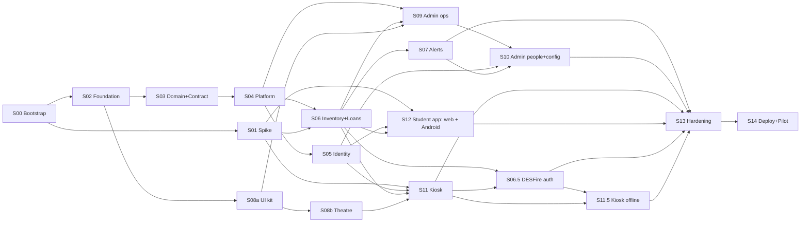

# ICTU LabPass — Construction Blueprint

**Objective.** Build a modern, futuristic inventory system for the **ICT University Cisco lab**:
- Students identify themselves at a lab PC with an **NFC school ID card**, a **virtual card on their phone**, or their **matricule**.
- They then **sign in (borrow)** and **sign out (return)** equipment.
- Admins manage equipment and stock, and get **low-stock alerts by email, SMS and WhatsApp**.
- Student data comes from the **school system or an imported file**.

| | |
|---|---|
| Status | **v1.3 — all Phase 0 decision gates answered or deferred to ICTU with tasks** (see changelog and decision log) · 2026-10-22 |
| Stack | TypeScript end-to-end: NestJS + PostgreSQL · Next.js admin · Electron kiosk · Expo (React Native) mobile |
| Mode | **GitHub mode** (since 2026-10-21): the remote is `origin` = <https://github.com/AyuknyamndiICTU/Inven-ICTU>. Each step runs on its own branch (`s01`, `s02`, … created as worktrees), which is pushed and merged into `main` through a **pull request** after review, then tagged `labpass/sNN`. CI (`ci.yml`) is created in S02. GitHub CLI is not installed, so open PRs in the browser or with GitKraken. |
| Shape | **18 steps in 10 waves** · 7 on the strongest model tier · critical path S00→S02→S03→S04→S06→S11→S06.5→S11.5→S13→S14 (S01 must also finish before S06) |

## Plan files

| File | What it is |
|---|---|
| [00-blueprint.md](./00-blueprint.md) | This index: requirements map, graph, invariants, protocol, risks, decision gates |
| [plan.md](./plan.md) | **Progress tracker**: phases, milestones M0–M11 and checkbox tasks (`[ ]` todo · `[/]` in progress · `[x]` done) |
| [01-architecture.md](./01-architecture.md) | `ARCH §1–§9`: stack, context, domain model, flows F1–F9, tap protocol, DESFire cards, security, API, import |
| [02-design-direction.md](./02-design-direction.md) | `DESIGN §1–§8`: direction per surface, evidence from the videos and HorizonX, tokens, motion, animations A1–A13/E1, screens, states, budgets |
| [03-steps-foundation-backend.md](./03-steps-foundation-backend.md) | Steps **S00–S07** (+ inserted **S06.5**) |
| [04-steps-surfaces-release.md](./04-steps-surfaces-release.md) | Steps **S08a–S14** (+ inserted **S11.5**) |
| [references/](./references/) | 17 annotated frames from the two videos and HorizonX. Internal reference only, never shipped |

## Requirements traceability

| # | Requirement (from the brief) | Where it is designed | Built in |
|---|---|---|---|
| R1 | Tap a physical NFC school ID card on a reader connected to the lab PC | ARCH §5 F1, §6 (DESFire EV3 cards, decision Q1) | S01, S06, S06.5, S11 |
| R2 | Use a virtual NFC ID on the phone | **Android app**: HCE tap (F2). **Web app** on any phone (iPhone, Android without the app or without NFC): **Scan-the-Kiosk** with a passkey (F3). Browsers cannot emulate NFC cards, and iOS HCE is unavailable in Cameroon (decision Q10) | S01, S06, S11, S12 |
| R3 | Student info is displayed instantly after identification | DESIGN A2/A3; ≤ 800 ms p95 | S06, S11 |
| R4 | Sign in equipment via a dropdown; same for sign out | ARCH §5 F5/F6 · DESIGN K4/K5 (combobox) | S06, S08a, S11 |
| R5 | Connect to the school system **or** import a file of students | ARCH §9 · `StudentDirectory` port | S05, S10 |
| R6 | Matricule entry when the student has no card or phone | ARCH §5 F4 · DESIGN K7 · ⚠ see deviation D1 | S05, S06, S11 |
| R7 | Admin adds equipment and increases or decreases quantity | ARCH §4 stock math · DESIGN Inventory | S06, S09 |
| R8 | Admin-configured alert level; alerts by WhatsApp, SMS and email | ARCH §5 F8 · real-channel gate in S14 | S07, S10, S14 |
| R9 | Mobile request sent to admin, **auto-approved when details match** the school system | ARCH §5 F7 | S05, S10, S12 |
| R10 | Three platforms: student mobile, lab-PC kiosk, admin page | ARCH §2. The student platform = installable **web app** + **Android app** from one codebase (decision Q10) | S09–S12 |
| R11 | Futuristic design and animation inspired by HorizonX and the two videos | DESIGN §1–§4, references/ | S08a, S08b, S09–S12 |
| R12 | Use the best installed ECC skills and agents | Per-step skills/agents and the roster below | all |
| R13 | The kiosk keeps recording loans when the network or server is down, and syncs later (added by decision Q6) | ARCH §5 F9 | S11.5 |

**Deliberate deviations (✅ confirmed by ICTU on 2026-10-20):**
- **D1** — Matricule entry displays the student's name and photo immediately, as requested. By default, borrowing then needs a PIN (set in the app or at an assisted visit) or a lab-assistant confirmation. This stops anyone who knows a classmate's matricule from borrowing under their name. A SUPER_ADMIN can switch to `OPEN` (Q9).
- **D2** — Phones without the LabPass Android app use the **Scan-the-Kiosk** credential instead of NFC (ARCH §2): iPhones, phones using the web app, and Android phones without NFC. Apple does not allow HCE in Cameroon, and no browser can emulate an NFC card.
- **D3** (✅ chosen 2026-10-22, decision Q10) — The student platform is **one codebase with two targets**: an installable **web app** (passkeys + Scan-the-Kiosk) for every phone, and an **Android app** with NFC tap, distributed as an APK from a campus download page. **No app store release for the pilot.**

## Step index

| ID | Step | Depends on | Parallel with | Tier | Size | Key ECC skills |
|---|---|---|---|---|---|---|
| [S00](./03-steps-foundation-backend.md#s00--repository-bootstrap) | Repository bootstrap | — | — | default | XS | git-workflow |
| [S01](./03-steps-foundation-backend.md#s01--hardware-platform--sis-spike-de-risk-freezes-the-tap-protocol) | Hardware, platform & SIS spike | S00 | S02, S03 | default | M* | search-first, architecture-decision-records, benchmark |
| [S02](./03-steps-foundation-backend.md#s02--monorepo-foundation-tokens--motion-package) | Monorepo, tokens, motion | S00 | S01 | default | M | coding-standards, docker-patterns, design-system, motion-foundations |
| [S03](./03-steps-foundation-backend.md#s03--domain-model-api-contract--draft-tap-protocol-contract-first) | Domain model, contract, draft protocol | S02 | S01, S08a | **strongest** | M | contract-first, api-design, prisma-patterns, postgres-patterns |
| [S04](./03-steps-foundation-backend.md#s04--api-platform-auth-rbac-devices-settings-idempotency-outbox-realtime) | API platform | S03 | S08a, S08b | default | L | nestjs-patterns, error-handling, redis-patterns, security-review |
| [S05](./03-steps-foundation-backend.md#s05--identity-student-directory-card-binding-enrollment--push) | Identity: directory, cards, enrollment, push | S04 (+S01 SIS) | S06, S08b | default | L | nestjs-patterns, hexagonal-architecture, tdd-workflow |
| [S06](./03-steps-foundation-backend.md#s06--operations-inventory-loans--identify-the-core-engine) | Inventory, loans & identify | S04, S01 | S05, S08b | **strongest** | L | postgres-patterns, tdd-workflow, security-review |
| [S06.5](./03-steps-foundation-backend.md#s065--desfire-ev3-card-authentication-inserted-by-decision-q1) | DESFire EV3 card authentication | S06, S01, S11 slice (a) | S10, S11 (later slices), S12 | **strongest** | M | security-review, tdd-workflow, hexagonal-architecture |
| [S07](./03-steps-foundation-backend.md#s07--notifications--low-stock-alerts-email--sms--whatsapp) | Notifications & alerts | S06 | S09, S11, S12 | default | M | redis-patterns, mailtrap-email-integration, i18n-sync |
| [S08a](./04-steps-surfaces-release.md#s08a--ui-kit--accessible-primitives-states--css-level-signatures-packagesui) | UI kit: primitives & states | S02 | S03, S04 | default | M | frontend-design-direction, design-system, accessibility |
| [S08b](./04-steps-surfaces-release.md#s08b--signature-theatre--webgl-scenes) | Signature theatre & WebGL | S08a | S04–S06 | **strongest** | M | motion-advanced, react-performance |
| [S09](./04-steps-surfaces-release.md#s09--admin-console--operations-inventory-loans-dashboard-kiosks) | Admin — operations | S04, S06, S08a | S07, S11, S12 | default | L | nextjs-turbopack, react-patterns, e2e-testing |
| [S10](./04-steps-surfaces-release.md#s10--admin-console--people-credentials--configuration) | Admin — people & config | S09, S05, S07 | S11, S12 | default | L | react-patterns, click-path-audit, i18n-sync |
| [S11](./04-steps-surfaces-release.md#s11--kiosk-app-electron--nfc-reader--the-showpiece) | Kiosk app (Electron + NFC) | S01, S05, S06, S08b | S07, S09, S12 | **strongest** | L | motion-advanced, security-review, react-performance |
| [S11.5](./04-steps-surfaces-release.md#s115--kiosk-offline-mode-inserted-by-decision-q6) | Kiosk offline mode & sync | S11, S06.5 | S10, S12 | default | M | backend-patterns, error-handling, security-review |
| [S12](./04-steps-surfaces-release.md#s12--student-app-expo--installable-web-app--android-nfc-app) | Student app: web app (PWA) + Android NFC app | S01, S05, S06 | S07, S09, S11 | **strongest** | L | react-native-patterns, security-review, browser-qa |
| [S13](./04-steps-surfaces-release.md#s13--hardening-security--end-to-end-qa) | Hardening, security & E2E QA | S07, S09–S12, S06.5, S11.5 | — | **strongest** | M | security-review, verification-loop, production-audit |
| [S14](./04-steps-surfaces-release.md#s14--deployment-pilot--handover) | Deploy, pilot & handover | S13 | — | default | M | deployment-patterns, canary-watch |

\* S01 also has a hardware lead time. On day 1, order the readers, webcam, test phones and blank DESFire EV3 sample cards.

## Dependency graph & waves

| Wave | Steps (parallel) | Notes |
|---|---|---|
| W0 | S00 | Creates the repo + worktrees |
| W1 | S01 ∥ S02 | Order hardware and DESFire sample cards immediately. **Send the card specification to the supplier** |
| W2 | S03 ∥ S08a (∥ S01) | S03 writes the protocol **draft**; S01 freezes it |
| W3 | S04 ∥ S08b | |
| W4 | S05 ∥ S06 | S06 waits for S01's frozen protocol. Parallel-work rule in S05/S06 |
| W5 | S07 ∥ S09 ∥ S11 ∥ S12 | Largest wave: backend, web, kiosk and mobile developers in parallel |
| W6 | S10 ∥ S06.5 | S06.5 can start once S11 slice (a) has merged |
| W7 | S11.5 | Offline mode (decision Q6) |
| W8 | S13 | |
| W9 | S14 | Real-channel gate + 2-week pilot |

Rough effort for a team of 3–4 experienced developers: **17–21 weeks** to go-live, pilot included.
That is 2 weeks more than v1.1, for the offline mode (Q6) and DESFire card authentication (Q1). Refine after S01.

## Invariants (re-verified at the end of every step once enforced)

| ID | Invariant | Enforced from | How it is checked |
|---|---|---|---|
| I1 | Build, lint, typecheck and tests are green | S02 | `pnpm verify` |
| I2 | Stock is never negative or above total, and the ledger reconciles | S03 (DB), S06 (reconcile) | DB `CHECK`s + property tests + `pnpm ops:reconcile` = 0 |
| I3 | The OpenAPI contract is the source of truth; generated clients are current | S03 | `pnpm contracts:check` |
| I4 | No PII, raw UIDs, OTPs, PINs, tokens or secrets in logs, errors, the repo or the kiosk renderer | S02 (secretlint), S04 (redaction) | Redaction tests, pre-commit `secretlint`, `pii-detector` reviews, kiosk "renderer cannot read token" test |
| I5 | Every animation uses `packages/motion` tokens, has an exit, honours reduced motion, and never blocks input | S02 (lint), S08a (UI) | No-raw-motion lint rule, reduced-motion stories, finish gate |
| I6 | Domain code never imports Prisma, provider SDKs or Electron APIs directly | S02 | ESLint import-boundaries rule |
| I7 | Mutating admin actions are audited; the ledger and audit log are append-only; mutations are idempotent | S03 (triggers), S04 (`@Audited`, idempotency) | Trigger tests, audit coverage test, same-key concurrency tests |
| I8 | The kiosk never crashes on reader or network failure; it shows K9 with a next action | S11 | Kiosk e2e + S13 chaos |

Before an invariant's "Enforced from" step, record it as *not yet applicable*.

## Execution protocol (cold start, any agent)

1. **Read** the Invariants, your step block, and only the `ARCH §`/`DESIGN §` sections it cites.
2. **Load** the step's ECC skills (e.g. `skill: nestjs-patterns`). For UI steps, also load `frontend-design-direction`.
   The ECC `plan-orchestrate` skill can read this plan and emit a ready-to-paste command for any step.
3. **Isolate parallel work**: `git worktree add ..\labpass-sNN -b sNN`. Push the branch and merge it into `main` through a pull request, following the step's parallel-work rule.
4. **Deliver L steps as their PR slices.** For each slice: failing tests first (`tdd-workflow`), then implement, then run the slice's checks + `pnpm verify`.
5. **Review**: run `verification-loop`, then a `code-review` agent on the diff (plus `security-review` for S04–S07 and S11–S13). Fix every high-confidence finding.
6. **Record**: Conventional Commit `feat(sNN): …`, tag `labpass/sNN`. In [plan.md](./plan.md), tick the step's tasks and acceptance boxes and update the dashboard. Add a changelog row here if the plan changed.
7. **Mutate, don't improvise**: if reality differs from the plan, use the mutation protocol.

Claude Code + Ruflo users can run each step as the `researcher → architect → coder → tester → reviewer` pipeline from their `CLAUDE.md`
(coordinated through `SendMessage`), then store what worked with `memory store --namespace patterns`.

### Agent roster (installed ECC agents → where they are used)

| ECC agent (`~/.claude/agents`) | Used in | Copilot CLI equivalent |
|---|---|---|
| `core/planner` | S01, plan mutations | `rubber-duck` |
| `architecture/arch-system-design` | S02, S03 | `general-purpose` |
| `v3/ddd-domain-expert` | S03 (bounded contexts) | `general-purpose` |
| `documentation/docs-api-openapi` | S03 | `general-purpose` |
| `development/dev-backend-api` | S04–S07 | `general-purpose` |
| `testing/tdd-london-swarm` | S04, S06, S09 | `task` |
| `v3/security-architect` | S04–S07, S06.5, S11–S13 | `security-review` |
| `v3/pii-detector` | S05, S10, S12, S13 | `security-review` |
| `v3/performance-engineer` | S06, S08b, S11, S13 | `general-purpose` |
| `specialized/spec-mobile-react-native` | S12 | `general-purpose` |
| `testing/production-validator` | S13, S14 | `task` |
| `devops/ops-cicd-github` | S02, S14 | `general-purpose` |
| `analysis/code-analyzer` | S08b + every step review | `code-review` |

## Risk register

| ID | Risk | Likelihood / impact | Mitigation (step) |
|---|---|---|---|
| RSK-01 | The new NFC cards are issued late, or with a chip/personalisation that doesn't match the spec | Med / High | Card spec sent to the supplier in M0; blank DESFire EV3 samples validated in S01; supplier samples get an acceptance test; phone and matricule + PIN cover students until cards arrive |
| RSK-02 | `nfc-pcsc` (2021) / `pcsclite` (2020, `nan`) won't build for current Electron | **Med–High** / Med | `ReaderDriver` port; utilityProcess or sidecar (ADR-0002, S01) |
| RSK-03 | Android HCE is flaky on some phones or readers | Med / Med | ACR1252U; native headless service tested in S01; Scan-the-Kiosk is always available |
| RSK-04 | iPhones cannot do HCE in Cameroon, and browsers cannot emulate NFC | Certain / Low | Web app with passkeys + Scan-the-Kiosk on every phone; Android app keeps NFC tap (S12) |
| RSK-05 | SIS has no API, or lacks DOB/phone/email | Med / Med | File import; contacts optional; no contact → admin review (S05) |
| RSK-06 | WhatsApp Business verification or template approval delays | Med / Med | Template submitted in S07; mandatory real-channel gate or signed deferral in S14 |
| RSK-07 | SMS cost or deliverability in Cameroon | Med / Low | Provider port; hysteresis + digest (S07) |
| RSK-08 | Lab PC GPU too weak for the theatre | Med / Low | S08a/S08b split, `detect-gpu`, `motionLevel`, gate on real hardware in S11 |
| RSK-09 | Campus network or server outage | Med / Med | Offline mode with later sync (S11.5); monitoring + kiosk-offline alerts (S14) |
| RSK-10 | Student PII exposure | Low / High | Role scoping, redaction, retention, audited CSV-safe exports, legal approval (Q11) |
| RSK-11 | Animation scope creep delays delivery | Med / Med | Fixed IDs A1–A13/E1, theatre isolated in S08b, budgets in DESIGN §7 |
| RSK-12 | No code-signing certificate for kiosk updates | Med / Med | Auto-update disabled without signing; manual-update runbook (Q12) |
| RSK-13 | DESFire key custody: application keys are leaked, lost, or held only by the card supplier | Low / High | ICTU owns the master key, and per-card keys are derived from it (NXP AN10922). Keys stay server-side and the kiosk only relays (S06.5). Key ceremony and escrow runbook (S14) |
| RSK-14 | Offline mode accepts a credential revoked during the outage, or offline loans conflict with stock changes made elsewhere | Med / Med | Maximum offline window (default 8 h, then read-only); assistant-only manual entry offline; sync conflicts go to an admin review queue and never break I2 (S11.5) |
| RSK-15 | The on-campus server is not reachable from the internet, or has no publicly trusted certificate | Med / **High** | **Passkeys and PWA install need HTTPS with a publicly trusted certificate on a real domain, even on campus.** ICTU IT creates a `labpass` subdomain and gets a public certificate (Let's Encrypt DNS-01 or ICTU wildcard), which needs no inbound exposure (Q13). Without public reachability: students use the app on campus Wi-Fi only, and WhatsApp runs without delivery receipts |
| RSK-16 | Passkeys are synced (iCloud Keychain / Google Password Manager) and can be shared with other people, so a student could share their credential | Med / Low | The kiosk shows the student's photo at every identification; BE/BS flags are recorded; loans are audited; the risk equals lending a physical card. Admins can require the Android app or card for repeat offenders |
| RSK-17 | Sideloaded APK: students reluctant to enable "install unknown apps", fake APKs circulating, signing key lost | Med / Med | Official download page on the LabPass domain with checksum + QR; in-app update prompt via `/meta/app-config`; ICTU holds the signing key with an escrow copy; the web app is always an alternative; Google Play later if accounts exist |

## Decision gates (open questions for ICTU)

Status: ✅ decided · 🟨 partly decided / under investigation · ⬜ open (the safe default applies)

| # | Question | Owner | Needed by | Safe default if unresolved | Status · decision (2026-10-20 / 2026-10-22) |
|---|---|---|---|---|---|
| Q1 | Which chip are ICTU ID cards? Is the UID fixed and recorded anywhere? | ICTU IT + S01 lead | S01 exit (before S06) | UID binding if stable; otherwise phone or matricule + PIN | ✅ The cards **have no NFC chip yet**; it is being added to new cards. ICTU will ask the supplier for **MIFARE DESFire EV3** and a **UID ↔ matricule file**. → card spec (S01), S06.5 |
| Q2 | Which SIS? API (auth?) or export? Which fields (DOB, phone, email, photo)? | Registry / IT | S05 start | File import only | 🟨 Unknown; to be found with Registry/IT during S01 |
| Q3 | Confirm **Sign In = borrow**, **Sign Out = return** | Lab admin | S06 | As stated (labels configurable) | ✅ Sign In = borrow, Sign Out = return |
| Q4 | Loan rules: same-day or multi-day? Max items? Block overdue students? | Lab admin | S06 | Due at lab closing; max 5 items; block when overdue | ✅ Due by lab closing time · **no item limit** (`maxItemsPerStudent = null`) · overdue students are blocked |
| Q5 | SMS provider and budget; who owns the Meta Business / WhatsApp sender number? | ICTU admin / finance | Provider: S07 · accounts: S14 gate | Email live; SMS/WhatsApp flagged off until provided | 🟨 SMS provider to be compared in S07 (local Cameroonian gateway vs international). ✅ **ICTU will create/verify a Meta Business account with a dedicated number**; start now (lead time) |
| Q6 | Must the kiosk **queue loans offline**? | Lab admin | S11 | Degraded/read-only (no offline loans) | ✅ **Yes**, offline loans are required. New step **S11.5** (+~2 weeks) |
| Q7 | Hosting: on-campus server or VPS? Public domain? | ICTU IT | Staging by S09 · production by S14 | On-campus Docker host + ICTU subdomain with a publicly trusted certificate | ✅ **On-campus server managed by ICTU IT**. Public reachability → Q13 |
| Q8 | Lab PC OS edition, specs, number of kiosks | ICTU IT | S01 | Windows 10/11, one kiosk | ✅ **One kiosk PC in the Cisco lab, Windows 10/11**. S01 still audits specs and GPU |
| Q9 | Manual-entry policy (D1) | Lab admin + ICTU security | S06 | `PIN_OR_ASSISTANT` | ✅ `PIN_OR_ASSISTANT`; D1 confirmed |
| Q10 | How do students get the app? (Store accounts with Apple and Google need a D-U-N-S number) | ICTU admin | S12 · S14 | Android pilot APK; web app for everyone else | ✅ **Hybrid (D3)**: installable **web app** for every phone + **Android app (APK)** with NFC tap, from one codebase. **No store accounts for the pilot**; stores are optional later |
| Q11 | Brand assets; data-protection approval for student PII | Communications / legal | Branding: S08a (tokens updatable) · approval: before real data in S14 | Signal palette; synthetic data only | 🟨 Deferred. **ICTU Communications will provide the logo and colours**; placeholders until then (task in M6). **Not yet approved**: synthetic data only until ICTU's data-protection/legal officer signs off **before the pilot** (task in M11) |
| Q12 | Code-signing certificate (or signing service) for the kiosk installer | ICTU IT | S14 | Manual kiosk updates, auto-update off | 🟨 Deferred. **ICTU IT will check**; kiosk updates are installed manually until then (task in M11) |
| Q13 | Can the on-campus server be reached from the internet at a public domain (e.g. `labpass.ictuniversity.edu.cm`)? Needed for the student apps off campus and for WhatsApp delivery webhooks. **Regardless of the answer**, the web app needs an ICTU subdomain with a publicly trusted certificate (RSK-15) | ICTU IT | Subdomain + certificate: before S12 device testing · reachability: S07 / S14 | Campus Wi-Fi only; WhatsApp without delivery receipts | 🟨 Deferred. **ICTU IT will check**; campus Wi-Fi only until then (tasks in M9 and M11) |

**Decisions to remember when implementing**
- **Deviations:** D1 and D2 were confirmed by ICTU on 2026-10-20. D3 was chosen on 2026-10-22.
- **Q1 (cards):** the card supplier is asked for MIFARE DESFire EV3 (≥ 2 KB), **random UID disabled**, and a LabPass application with AES keys derived per card from an ICTU-owned master key. Keys are injected at personalisation in a key ceremony, and the supplier never keeps them. The supplier also delivers a `card_uid,matricule` file per batch, which the student import (S05) binds automatically. The spec is `docs/protocols/card-personalisation-v1.md` (S01).
- **Q4 (loan rules):** `maxItemsPerStudent = null` (unlimited), due time = lab closing time (a setting), and overdue students are blocked.
- **Q6 (offline):** offline loans are required. The kiosk keeps working and syncs later (ARCH §5 F9, step S11.5).
- **Q10 (student app, D3):** Expo builds a **web target (PWA)** and an **Android target** from the same code.
  - **Web app:** WebAuthn **passkeys** (`@simplewebauthn`) + camera Scan-the-Kiosk. It is served **same-origin** with the API.
  - **Android app:** a Keystore device key + HCE tap. It is distributed as an ICTU-signed APK at `/download/android`.
  - The iOS native build and app stores are deferred.
- **Q13 (domain):** passkeys require an ICTU subdomain with a **publicly trusted** TLS certificate, even if the server stays campus-only. An internal CA is not enough.

## Plan mutation protocol

| Mutation | Rule |
|---|---|
| **Split** | `S06` → `S06a`/`S06b`. Each half gets its own context brief, verify block and exit criteria. Update the index and graph |
| **Insert** | Use a half-step ID (e.g. `S06.5 DESFire auth`). Declare its dependencies and add it to a wave |
| **Skip** | Mark the step `⏭ skipped` with a reason and confirm no dependent step needs its output |
| **Reorder** | Only when the dependency graph allows it. Redraw the mermaid graph |
| **Abandon** | Mark the step `✖`, run its Rollback, and record the follow-up |

Every mutation adds a changelog row naming the trigger (e.g. an S01 finding) and the affected steps.

## Changelog

| Date | Change | Trigger |
|---|---|---|
| 2026-10-19 | v1 drafted: 14 steps, ARCH + DESIGN companions, 17 reference frames | Initial brief |
| 2026-10-19 | **v1.1** — Fixed all 7 critical findings (list below) | Adversarial review: 7 critical, 14 major, 4 minor |
| 2026-10-19 | v1.1 — Fixed the 14 major findings (list below) | Same review |
| 2026-10-19 | v1.1 — Fixed the 4 minor findings: UID survey aggregate/HMAC only; risk IDs renamed `RSK-xx` (they clashed with kiosk screens K1–K10); separate HCE metrics; invariants gained "enforced from" | Same review |
| 2026-10-20 | S00 done: repository created, commit `9e2e776`, tag `labpass/s00`, worktrees `labpass-s01` and `labpass-s02` | Phase 0 |
| 2026-10-20 | **v1.2** — Inserted **S06.5** (DESFire EV3 card authentication); Q1 now asks for card specification + UID file from the supplier; S01 card task validates blank DESFire samples instead of surveying existing cards | Decision Q1: no NFC cards yet; DESFire EV3 chosen |
| 2026-10-20 | v1.2 — Inserted **S11.5** (kiosk offline mode + sync, ARCH §5 F9); added R13; S13 depends on S06.5 and S11.5; estimate 17–21 weeks | Decision Q6: offline loans required |
| 2026-10-20 | v1.2 — `maxItemsPerStudent` unlimited; D1/D2 confirmed; new question Q13 (public reachability); new risks RSK-13 to RSK-15 | Decisions Q4, Q7, Q9, D1, D2 |
| 2026-10-22 | **v1.3** — Student platform changed to the **hybrid D3**: one Expo codebase → installable web app (passkeys + Scan-the-Kiosk) + Android APK (NFC tap). iOS native build and app stores dropped for the pilot. ARCH §2/§4/§5/§6/§7/§8, DESIGN §5/§7/§8, S01, S03, S05, S06, S11, S11.5, S12 (rewritten), S13 and S14 updated | Decision Q10, prompted by the question "can a web app use phone NFC?" (answer: browsers cannot emulate NFC cards) |
| 2026-10-22 | v1.3 — Q8 decided (one Windows kiosk); Q11, Q12 and Q13 deferred to ICTU, with tasks in M6, M9 and M11; hosting requires a publicly trusted certificate (internal CA dropped); new risks RSK-16 (passkey sharing) and RSK-17 (sideloaded APK); RSK-15 raised to High impact | Decisions Q8, Q11, Q12, Q13 |

**Critical fixes in v1.1**
1. Idempotency is stored in the same database transaction as the change (F5/F6); Redis is only a cache.
2. Manual entry needs PIN or assistant confirmation by default (D1).
3. The kiosk token stays in the main process; the renderer only gets business IPC calls.
4. The bearer QR was replaced by the **Scan-the-Kiosk** challenge-response.
5. Auto-update requires signed builds.
6. A mandatory real-channel gate for SMS and WhatsApp was added to S14.
7. New **S00** bootstrap step, so the S01/S02 worktrees have a repository.

**Major fixes in v1.1**
- **Steps:** tap protocol is a draft in S03 and frozen in S01; S08 split into S08a/S08b; PR slices for every L step.
- **Dependencies:** S05/S06 parallel-work rule; settings and kiosk config moved to S04; Expo push moved to S05.
- **Concurrency:** enrollment session + proof of possession, with a partial unique index for one active credential; return/force-return concurrency.
- **Alerts:** outbox inbox, `SKIP LOCKED`, per-equipment serialisation, `AlertOccurrence`.
- **Protocol:** byte-level spec plus malformed test vectors.
- **Import:** contacts optional; zip-bomb, CSV-injection and SSRF defences built into S05.
- **Mobile:** native headless HCE spiked with real Keystore signing.
- **Commands:** `.\gradlew.bat`, `pnpm evidence:check`, iOS test job.
- **Rollbacks:** import rollback, paused (not dropped) notification queues, mobile kill switch.
- **Gates:** decision gates now have owners and safe defaults.
