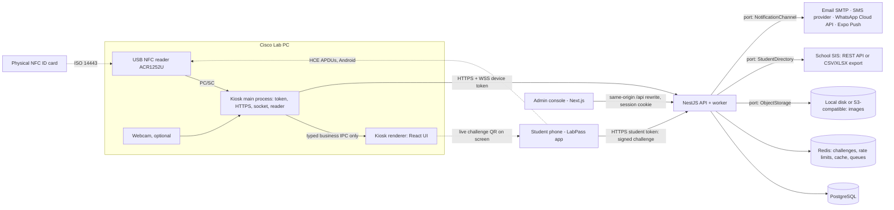

# ICTU LabPass — Architecture Reference

> Companion to [00-blueprint.md](./00-blueprint.md). Steps cite sections here as `ARCH §n`.
> Working product name: **LabPass** (rename freely). The byte-level tap protocol becomes normative in
> `docs/protocols/tap-protocol-v1.md` (written in S03, frozen at S01 exit); §6 is its summary.

## §1 Glossary & confirmed assumptions

| Term | Meaning |
|---|---|
| **Sign In** | A student **takes/borrows** equipment from the Cisco lab (stock goes down). |
| **Sign Out** | A student **returns** equipment (stock goes back up). Labels are configurable (Q3). |
| Matricule | The student's school registration number (unique, e.g. `ICTU20231234`). |
| SIS | The school's Student Information System — the source of truth for students. |
| Kiosk | The Cisco-lab PC running the LabPass desktop app, with a USB NFC reader. |
| Kiosk challenge | A single-use, server-issued 16-byte nonce bound to one kiosk (TTL 60 s). It drives every phone-based identification. |
| Virtual card | The student's phone credential, a hardware-backed P-256 key. Android with NFC **taps** it (HCE). Any phone (iPhone, Android without NFC) uses **Scan-the-Kiosk**: the app scans the kiosk's live challenge QR and signs it. |
| HCE | Android Host Card Emulation — the phone answers the reader like a smart card. |

Open questions and decision gates are in [00-blueprint.md → Decision gates](./00-blueprint.md#decision-gates-open-questions-for-ictu).

## §2 Surfaces & stack (decided)

| Surface | Tech | Users |
|---|---|---|
| `apps/api` | NestJS 11 (Fastify) · Prisma · PostgreSQL 17 · Redis 7 + BullMQ · Socket.IO · `ObjectStorage` port (local disk default, S3 optional) | all |
| `apps/admin` | Next.js (App Router) · Tailwind v4 · Radix · Motion · TanStack Query/Table | admins, lab assistants |
| `apps/kiosk` | Electron (electron-vite) · React · XState · `ReaderDriver` port (PC/SC) · OGL (WebGL) | students at the lab PC |
| `apps/mobile` | Expo (dev client / EAS) · Expo Router · Reanimated · Skia · `expo-camera` · custom native module `ictu-credential` | students |
| `packages/*` | `contracts` (OpenAPI → typed client, tap-protocol vectors) · `design-tokens` · `motion` · `ui` · `i18n` · `config` | shared |

Monorepo: pnpm workspaces + Turborepo. TypeScript strict everywhere. Backend follows **ports & adapters**.

### Platform facts that shaped the design (verified Oct 2026)
- **iOS HCE is EEA-only**, so it is unavailable in Cameroon. iPhones use **Scan-the-Kiosk** (camera + Secure Enclave key).
- Many budget Android phones (some Tecno/Infinix/itel models) **lack NFC**, so Scan-the-Kiosk works on every phone.
- **ACR122U is unreliable with Android HCE**. Standardise on **ACS ACR1252U** (or ACR1552U / HID Omnikey 5022).
- Web NFC does not exist on desktop browsers, so the kiosk is a native (Electron) app talking PC/SC.
- `nfc-pcsc` (last published 2021) wraps `@pokusew/pcsclite` (2020, `nan` + node-gyp), so it may not build for current Electron.
  The kiosk talks to readers through a `ReaderDriver` port. S01 decides between `nfc-pcsc` in a `utilityProcess`, a maintained
  fork, or a sidecar binary (ADR-0002).
- Android `HostApduService.processCommandApdu` runs on the app's **main thread** and may run with **no React Native runtime**.
  APDU handling is therefore fully native: it reads the credential from native storage and may answer asynchronously with `sendResponseApdu`.

## §3 System context



### Monorepo layout
```
apps/api            modules: platform, auth, settings, kiosks, students, directory, cards, credentials,
                    equipment, stock, loans, identify, notifications, alerts, reports, audit
apps/admin          Next.js admin console
apps/kiosk          main (reader, api client, socket, ipc) / preload / renderer (React)
apps/mobile         Expo app + modules/ictu-credential (Kotlin HostApduService + Keystore, Swift Secure Enclave)
packages/contracts  openapi.yaml, generated client, events/*.json, tap-protocol/{vectors.json, verify.ts}
packages/design-tokens · motion · ui · i18n · config
spikes/             throwaway hardware proofs (S01), never imported by apps
docs/adr  docs/protocols  docs/runbooks  docs/evidence  docs/security
```

## §4 Domain model

Bounded contexts: **Identity** (students, cards, credentials), **Inventory** (equipment, stock), **Lending** (loans),
**Notification** (channels, alerts), **Platform** (auth, settings, audit, outbox).

| Entity | Key fields | Notes |
|---|---|---|
| `Student` | matricule (unique), firstName, lastName, email?, phone? (E.164), dateOfBirth, program, level, photoKey?, status `ACTIVE/INACTIVE/SUSPENDED`, sisExternalId, sourceHash, manualPinHash?, syncedAt | Mirrors the SIS and is never hard-deleted. `pg_trgm` index on names. Email and phone are **optional**. |
| `DirectoryImport` / `DirectoryImportIssue` / `DirectoryImportChange` | source `FILE/REST`, counts, status, actor / row, field, message / studentId, **before jsonb**, after jsonb | Before-images allow a **compensating rollback** of a bad import. |
| `CardBinding` | studentId, uidHmac (HMAC-SHA256 with a server pepper), cardTech, status, createdVia `SIS/OTP/ADMIN` | Raw UIDs are never stored. |
| `EnrollmentSession` | id, matricule, submittedFields (jsonb), matchResult (per-field), otpHash, otpAttempts, otpVerifiedAt, popNonce, expiresAt (15 min), status | Binds all enrollment phases together (F7). |
| `MobileCredential` | id (UUID = credentialId), studentId, publicKeySpki, platform `ANDROID/IOS`, capabilities `{hce, scan}`, deviceLabel, attestation (jsonb, audit only), status `PENDING/ACTIVE/REVOKED/REJECTED`, tokenFamilyId | **Partial unique index**: one `ACTIVE` per student. |
| `CredentialRequest` | enrollmentSessionId, credentialId, decision `AUTO_APPROVED/PENDING/APPROVED/REJECTED`, reviewerId, verifiedInPerson, reason | The admin queue. |
| `PushToken` | studentId, expoPushToken, platform, lastSeenAt | |
| `EquipmentCategory` | name, icon, sortOrder | e.g. Routers, Switches, Cables… |
| `Equipment` | code (unique), name, categoryId, description, imageKey, unit, `totalQuantity`, `availableQuantity`, `lowStockThreshold?` (null → global default), active, version | `CHECK (available >= 0 AND available <= total)`. |
| `StockMovement` | equipmentId, type `RESTOCK/WRITE_OFF/CORRECTION/ISSUE/RETURN/DAMAGED/LOST`, delta, actorType, actorId, loanLineId?, kioskId?, reason, createdAt | **Append-only** (a trigger blocks UPDATE/DELETE). |
| `Loan` / `LoanLine` | Loan: studentId, kioskId, identifyMethod `CARD/HCE/SCAN/MANUAL`, manualVerification `PIN/OTP/ASSISTANT/OPEN`?, openedAt, dueAt, closedAt, status. Line: equipmentId, qtyIssued, qtyReturned, qtyDamaged, qtyLost | Partial returns are allowed. `CHECK (returned + damaged + lost <= issued)`. |
| `Kiosk` | name, location, tokenHash, lastSeenAt, appVersion, status | Device authentication. |
| `AdminUser` | email, name, role, argon2 hash, totpSecret (encrypted), phoneE164?, whatsappE164?, phoneVerifiedAt?, notificationPrefs | Roles in §7. |
| `AlertRule` | scope (global or equipmentId), threshold, channels, recipients | |
| `AlertOccurrence` | id, equipmentId, severity `LOW/OUT`, threshold, availableAtFire, firedAt, resolvedAt? | Its id keys notification jobs. An open occurrence means "disarmed". |
| `NotificationLog` | occurrenceId?, channel, recipientMasked, template, status, providerMessageId, attempts, error | Delivery audit. |
| `Setting` | typed key/value (zod) | e.g. `manualEntryPolicy`, `loanDuePolicy`, `quietHours`, `maxItemsPerStudent`, `kioskMotionLevel`, labels. |
| `IdempotencyKey` | (scope, key) unique, requestHash, status `IN_PROGRESS/DONE`, responseStatus, responseBody, createdAt | Written **inside** the business transaction (F5). |
| `OutboxEvent` / `ConsumerInbox` | id, type, payload, createdAt, publishedAt? / (consumer, eventId) unique | Exactly-once effects on top of at-least-once delivery. |
| `AuditLog` | actor, action, entity, entityId, diff, ip, at | Append-only. |

**Stock math.** `availableQuantity` changes in the same transaction as its `StockMovement`.
Invariant: `total − available = Σ(qtyIssued − qtyReturned − qtyDamaged − qtyLost)` over all loan lines.
Admin increase/decrease moves `total` and `available` together, and may never push `total` below the quantity currently out.
Damaged or lost units reduce `total` (write-off) instead of returning to `available`.

## §5 Critical flows

**Kiosk challenge pool.** The kiosk main process keeps 3 fresh challenges from `POST /kiosk/challenges`.
Redis stores them as `kc:{kioskId}:{nonce}` with a 60 s TTL. A challenge is consumed atomically (`GETDEL`) on use and refilled at once.
The attract screen shows the newest one as a QR.

**F1 — Physical card.** A card is detected. The kiosk tries SELECT AID first, which fails for cards. It then reads the UID
(`FF CA 00 00 00`) and calls `POST /kiosk/identify {method:"CARD", uid}`. The API HMACs the UID and finds the `CardBinding`.
It returns the student summary, eligibility, open loan lines and a 2-minute `kioskSession` JWT bound to kiosk + student.
For an unknown card, the kiosk offers matricule entry and a *link this card* request (OTP to the SIS contact, or admin approval).

**F2 — Android tap (HCE).** SELECT AID returns the credentialId. The kiosk sends SIGN with a pool challenge, its kioskId and ts.
The phone signs natively and the kiosk posts `{method:"HCE", credentialId, nonce, ts, signature}`. The API verifies it (§6),
then responds as in F1. A locked phone gets no APDUs (`requireDeviceUnlock`), so the kiosk shows "Unlock your phone and tap again".

**F3 — Scan-the-Kiosk (any phone).** The student opens **Pass → Scan kiosk** and the camera reads the live challenge QR.
The app signs it with its hardware key and calls `POST /me/scan` (student token). The API verifies and consumes the challenge,
then emits `identified` to that kiosk's socket. The kiosk renders the student exactly as in F1.
**Offline phone fallback:** the app shows a response QR (§6), and the kiosk webcam (or an optional USB 2D scanner) reads it and posts
`{method:"SCAN", …}`. The response QR is bound to one kiosk challenge, so screenshots cannot be replayed.

**F4 — Manual matricule.** The student types a matricule. The kiosk shows **name + photo** (as the brief requires), then requires
verification before any Sign In/Out, according to `manualEntryPolicy`:
- `PIN_OR_ASSISTANT` (**default**): a 4–6 digit PIN the student set in the app, or at an assisted first visit. Argon2-hashed, 5 attempts → 15-minute lock. Without a PIN, a lab assistant confirms with their PIN.
- `OTP`: a code sent to the SIS contact.
- `ASSISTANT`: the assistant always confirms.
- `OPEN`: no verification. Only an explicit SUPER_ADMIN choice, with an on-screen warning and every loan flagged.

Lookups are rate-limited per kiosk, and unknown matricules return a generic message.

**F5 — Sign In (borrow).** A searchable combobox lists active equipment with live availability; the student picks a quantity per item
and builds a cart, then confirms with an `Idempotency-Key`. **One DB transaction:**
1. `INSERT idempotency_key … ON CONFLICT DO NOTHING`. On conflict: same hash + DONE → replay the stored response; IN_PROGRESS → `409 retry`; different hash → `422`.
2. Policy checks: ACTIVE, `maxItemsPerStudent`, overdue block.
3. For each line in `equipmentId` order: `UPDATE equipment SET available = available − q WHERE id = $1 AND available >= q`. 0 rows → `409` with current availability, and the transaction rolls back.
4. Insert the Loan, its LoanLines, StockMovements and an OutboxEvent; store the response in `idempotency_key`; COMMIT.

Redis only caches replayed responses. The database is the source of truth.

**F6 — Sign Out (return).** The dropdown lists **only the student's open loan lines**, each with quantity and condition `OK/DAMAGED`.
It follows the same idempotency pattern as F5. Lock order: loan lines by id, then equipment by id.
A conditional `UPDATE loan_line … WHERE (issued − returned − damaged − lost) >= $q RETURNING` makes duplicate or concurrent returns safe (0 rows → `409`).
OK units increment `available`. DAMAGED units become a write-off. The loan closes when every line is settled.
Admin force-return and stock adjustments use the same pattern.

**F7 — Mobile enrollment & auto-approval.**
1. `POST /enroll/start {matricule, firstName, lastName, dateOfBirth}` creates an `EnrollmentSession` (15 min).
   Fields are compared after normalisation: trim, collapse whitespace, Unicode NFC, case-fold. Accents and date must match exactly.
2. If all fields match and the SIS has a contact, a 6-digit OTP (hashed, 10 min, 5 attempts) goes to the **SIS-registered** email/phone.
   The masked destination is returned. If fields mismatch or there is no contact, the session is marked for review.
3. `POST /enroll/otp/verify {sessionId, code}` → `otpVerifiedAt`. The OTP state is then invalidated, and the response carries `popNonce`.
4. The app creates a non-exportable P-256 key (Android Keystore, StrongBox when available; iOS Secure Enclave). It then calls
   `POST /enroll/key {sessionId, spki, platform, capabilities, sig(popNonce)}`. This is **proof of possession**. The Android attestation chain is stored for audit only.
5. In one transaction locking the student row:
   - **All fields match + OTP verified + student ACTIVE → `AUTO_APPROVED`**: the credential becomes ACTIVE, the previous credential and its token family are revoked, and a push notification is sent.
   - Otherwise → `PENDING`, with a per-field diff in the realtime admin queue. Approving a mismatch requires `verifiedInPerson=true`.

   PENDING requests are rate-limited (3/day per matricule, 10/day per device).

**F8 — Low-stock alert.** A committed stock change writes `OutboxEvent(StockChanged)`.
1. The relay polls the outbox with `FOR UPDATE SKIP LOCKED` and enqueues work.
2. The AlertEvaluator job is **keyed per equipment**, so evaluation is serialised. It dedupes through `ConsumerInbox` and reads **current**
   stock rather than the event payload, so duplicate or reordered events are harmless.
3. If `available ≤ threshold` and there is no open occurrence: create an `AlertOccurrence` and enqueue one notification job per channel × recipient, keyed `occurrenceId:channel:recipient`.
4. If `available > threshold`: resolve the open occurrence (re-arm).
5. `available = 0` is severity OUT and bypasses quiet hours. Deliveries retry with backoff, fall through to a dead-letter queue, and are recorded in `NotificationLog`.

## §6 ICTU Tap Protocol v1 (summary of the normative spec)

**Encodings (all transports).**
- UUIDs (`credentialId`, `kioskId`): 16 raw bytes, RFC 4122 network order (same order as the hex string).
- `ts`: uint64 big-endian Unix milliseconds. `nonce`: 16 random bytes from the server.
- Signatures: ECDSA P-256/SHA-256, **DER (X9.62)**, 70–72 bytes. This is the default for Android `SHA256withECDSA`, iOS `.ecdsaSignatureMessageX962SHA256` and Node `crypto.verify`.
- Text payloads: base64url **without padding** (RFC 4648 §5).

**HCE APDUs** — AID `F0494354554C5001` ("ICTULP" + v1, proprietary `F` range).

| # | Command (kiosk → phone) | Response (phone → kiosk) |
|---|---|---|
| 1 | SELECT `00 A4 04 00 08 F0494354554C5001 00` | `01` (version) ‖ credentialId (16) ‖ `9000` · not enrolled `6A82` |
| 2 | SIGN `80 10 00 00 28` ‖ nonce (16) ‖ kioskId (16) ‖ ts (8) ‖ `00` | DER signature ‖ `9000` · key unavailable `6982` · bad length `6700` · unknown INS `6D00` · bad CLA `6E00` |

Signed message (HCE): ASCII `ICTU-LP1-HCE` ‖ credentialId ‖ nonce ‖ kioskId ‖ ts.

**Scan-the-Kiosk.**
- Challenge QR: `LPK1.<kioskId>.<nonce>`.
- Phone → API: `POST /me/scan {kioskId, nonce, ts, sig}`.
- Signed message (SCAN): ASCII `ICTU-LP1-SCAN` ‖ credentialId ‖ nonce ‖ kioskId ‖ ts.
- Offline response QR: `LPR1.<credentialId>.<nonce>.<ts as decimal>.<sig>`.

**Server acceptance (both methods).** All of the following must hold:
- The credential is ACTIVE and the signature verifies against the stored SPKI.
- `GETDEL kc:{kioskId}:{nonce}` succeeds, which proves the challenge was server-issued, belongs to this kiosk, and is unused.
- The kioskId matches the caller: the device token (HCE / response QR) or the target kiosk (`/me/scan`).
- `|now − ts|` ≤ 30 s (HCE: kiosk clock, NTP-synced) or ≤ 120 s (SCAN: phone clock).

**Android service.** `apduservice.xml`: category `other`, `android:requireDeviceUnlock="true"`, AID group as above.
The key uses `setUnlockedDeviceRequired(true)`. It tries StrongBox and falls back to the TEE on `StrongBoxUnavailableException`.

**Vectors.** `packages/contracts/tap-protocol/vectors.json` holds positive and **malformed** cases: truncated APDUs, wrong Lc,
bad DER, padding in base64url, wrong prefix/version, expired/consumed/foreign nonce, revoked credential.
They are shared by the API, the kiosk `FakeReader`, and the Kotlin/Swift tests.

**Physical cards.** UID identification is clonable on MIFARE Classic. That is acceptable for an audited lab-loan log
(the photo is shown at every identification). If cards are DESFire EV2/EV3 and the issuer shares an application key, add mutual
authentication as a new `identify` method (ADR-0003). If cards use random UIDs, UID binding does not work — resolve this in S01.

## §7 Security, privacy & roles

| Role | Can |
|---|---|
| `SUPER_ADMIN` | everything incl. admin users, SIS connector, provider secrets, kiosk registration, `OPEN` manual policy |
| `LAB_ADMIN` | equipment, quantities, thresholds, alerts, student import, credential approvals, reports |
| `LAB_ASSISTANT` | view inventory/loans, force-return, confirm manual entries (assistant PIN), limited student fields |
| `VIEWER` | read-only dashboards/reports |

**Admin console**
- argon2id passwords; TOTP mandatory for SUPER_ADMIN/LAB_ADMIN.
- Cookies `HttpOnly; Secure; SameSite=Strict`, plus an Origin check; lockout after repeated failures.

**Kiosk**
- A 256-bit device token, obtained by exchanging a one-time 10-minute registration code. Stored with `safeStorage` (DPAPI) and used **only in the main process**. All HTTPS/WSS calls are made there.
- The renderer gets a typed IPC surface of **business operations only** (identify, signIn, signOut, …). There is no token getter, no generic fetch and no arbitrary URL.
- Electron: `contextIsolation`, `sandbox`, no `nodeIntegration`, strict CSP, no remote content.
- Auto-update requires **signed installers** (Authenticode) served from an HTTPS, allow-listed, versioned feed, with signature verification. Without signing material, auto-update is **disabled** and updates are installed manually.

**Mobile app**
- Short-lived access JWT plus a rotating refresh token (reuse detection, family revocation) in `expo-secure-store`.
- `/meta/app-config` returns `minSupportedVersion`, which acts as a kill switch for bad builds.

**Abuse limits (Redis)**
- Rate limits on login, identify, manual lookup, enrollment, OTP send/verify, and `/me/scan`.

**Privacy**
- No PII, raw UIDs, OTPs or tokens in logs (I4). Recipients are masked in NotificationLog.
- A retention setting for loan history. Student fields are scoped by role. Exports are audited and **CSV-injection-safe**.
- Comply with Cameroonian data-protection law and ICTU policy (Q11).

**Secrets**
- Kept in env / Docker secrets. Provider tokens and TOTP secrets are encrypted at rest (AES-256-GCM).
- The WhatsApp webhook verifies `X-Hub-Signature-256` over the **raw body** and answers the GET verification handshake.

## §8 API surface (v1, REST + OpenAPI; errors as RFC 9457 problem+json)

| Area | Endpoints (abridged) |
|---|---|
| Auth | `POST /auth/login`, `/auth/totp`, `/auth/logout`, `GET /auth/me` |
| Settings | `GET/PUT /settings` (admin), `GET /kiosk/config` (kiosk); event `SettingsChanged` → `/kiosk` socket |
| Kiosks | `POST /kiosks` (admin → code), `POST /kiosks/register` (code → token), `POST /kiosks/heartbeat`, `POST /kiosk/challenges` |
| Identify | `POST /kiosk/identify` {CARD · HCE · SCAN · MANUAL}, `POST /kiosk/manual/verify` {PIN · OTP · ASSISTANT}; socket `identified` (from `/me/scan`) |
| Loans | `POST /kiosk/sign-in`, `POST /kiosk/sign-out` (Idempotency-Key), `GET /loans`, `POST /loans/{id}/force-return` |
| Equipment | CRUD `/equipment`, `/categories`; `POST /equipment/{id}/adjust`; `GET /equipment/{id}/movements` |
| Students | `GET /students`, `GET /students/{id}`; `POST /directory/imports` → preview, `…/{id}/commit`, `…/{id}/rollback`; connector config / test / sync; card bind/unbind, link requests |
| Mobile | `POST /enroll/start`, `/enroll/otp/verify`, `/enroll/key`; `GET /me`, `/me/loans`, `/me/credential`; `POST /me/scan`, `/me/push-token`, `/me/pin`, `/me/credential/revoke`; `GET /meta/app-config` |
| Credentials (admin) | `GET /credential-requests`, `POST …/{id}/approve` · `/reject`, `POST /credentials/{id}/revoke` |
| Alerts | `GET/PUT /alerts/rules`, `POST /notifications/test`, `GET /notifications/log`, `POST /admin-users/me/verify-phone`, `POST /webhooks/whatsapp` (+GET verify) |
| Reports/Audit | `GET /reports/usage`, `/reports/export`, `GET /audit` |
| Realtime | Socket.IO `/admin` (activity, stock, requests, kiosk status), `/kiosk` (availability, config, revocations, `identified`) |

## §9 Student import format

Template columns. EN/FR header aliases are auto-mapped, and a mapping UI allows overrides.
- **Required:** `matricule`, `first_name` (prénom), `last_name` (nom), `date_of_birth` (date_de_naissance).
- **Optional:** `email`, `phone`, `program` (filière), `level` (niveau), `status`, `card_uid` (creates a CardBinding), `photo_url`.

Auto-approval needs at least one SIS contact (email or phone) for the OTP. Students with no contact always go to admin review.

**Pipeline**
1. Upload, then parse: CSV via streaming papaparse with **delimiter auto-detect** (French Excel uses `;`) and BOM stripping; XLSX via the exceljs streaming reader.
2. Map columns, then validate (zod).
3. **Dry-run diff**, then commit in batches. Each changed student's before/after is stored, so a bad import can be **rolled back by compensation**.
4. Optionally mark students missing from the source as `INACTIVE` (never delete). Re-importing the same file produces zero changes.

**Limits & defences**
- File ≤ 20 MB; inflated XLSX ≤ 100 MB (checked while streaming entries); ≤ 100k rows, ≤ 60 columns, cells ≤ 1,000 chars.
- Formulas are read as cached values only.
- `photo_url` must be `https` on an allow-listed host. A worker fetches it (≤ 2 MB), re-encodes it as an image, and stores it in ObjectStorage.
- Every generated CSV (error reports, exports) is CSV-injection-sanitised.

The REST SIS adapter uses the same pipeline, with configurable base URL (host allow-list), auth (API key / OAuth2 client credentials),
pagination and field mapping, on a schedule.
